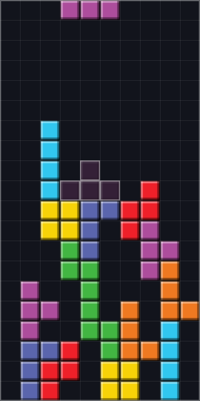
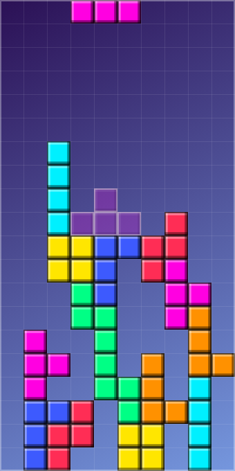
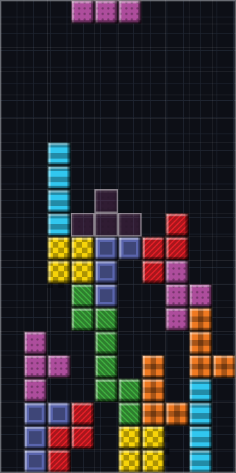
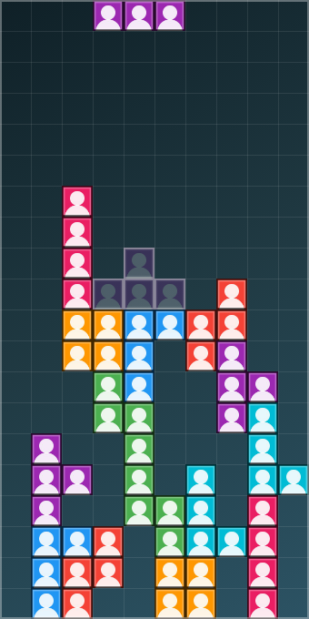
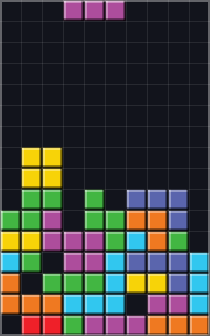
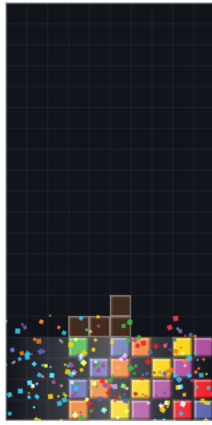
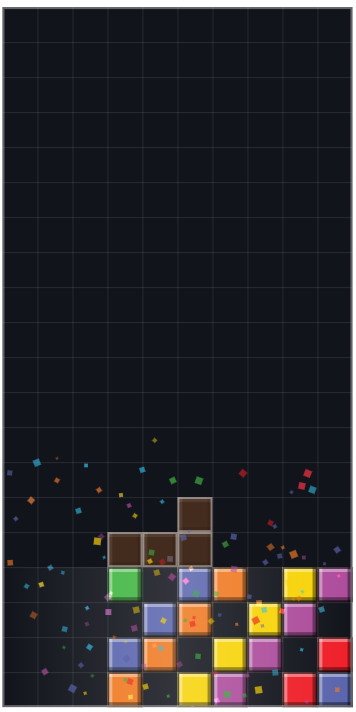
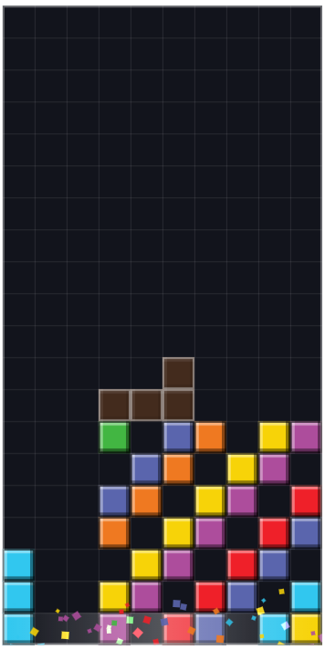

# Tetris — Projeto Integrador

Jogo estilo Tetris feito em **HTML5 Canvas + JavaScript puro (ES Modules)**, sem framework e sem etapa de build.

O diferencial do projeto não é o jogo em si — é a **arquitetura**: a lógica de jogo está tão separada da parte visual que dá para trocar os blocos coloridos por fotos de rostos **sem alterar uma única linha do código de jogo**, e ainda no meio da partida.

| Mesma partida, mesma lógica, aparências diferentes |
|---|
|      |

As cinco imagens acima são **o mesmo instante da mesma partida** — mesmas peças, mesmas posições, mesma lógica. Só a skin ativa mudou.

---

## Como rodar

Só é preciso ter o **Node.js 18 ou superior** instalado.

```bash
npm run dev
```

Depois abra <http://localhost:3050>.

Para rodar os testes automatizados da lógica de jogo:

```bash
npm test
```

Não há `npm install`: o projeto **não tem nenhuma dependência externa**. Nem para o jogo, nem para os gráficos, nem para o servidor de desenvolvimento.

---

## O que o jogo tem

**Jogabilidade**
- Tabuleiro 10×20 seguindo o *Tetris Guideline* (o padrão dos jogos oficiais)
- Rotação SRS com *wall kicks* — permite encaixar peças junto a paredes e em poços
- Sorteio 7-bag: as sete peças são embaralhadas e distribuídas, sem sequências injustas
- Sombra da peça, reserva (*hold*), fila de próximas peças, *lock delay*
- Pontuação oficial, com bônus de 50% para dois Tetris seguidos
- 5 modos de um jogador: **Maratona**, **Sprint** (40 linhas), **Ultra** (2 minutos), **Zen** (sem fim) e **Professores**

**Dois jogadores na mesma tela**
- **Dois tabuleiros**: cada um no seu. Limpar linhas envia lixo para o adversário, e os poderes de professor podem ser mirados nele. Perde quem estourar primeiro.
- **Um tabuleiro, duas peças**: os dois disputam o mesmo tabuleiro, cada um com a sua peça caindo ao mesmo tempo. A linha é creditada a quem a fechou, e dá para bloquear o espaço do outro.
- Teclado dividido (WASD e setas) ou **dois controles de videogame**, pela Gamepad API

**Modo Professores Especiais**
- Algumas peças trazem um bloco marcado com um professor
- Encoste dois professores (na horizontal ou vertical) e um **poder especial** dispara
- **15 combinações, todas implementadas** — explosões, cruz, varredura, linha e coluna coringa, blocos-bomba, compactação da pilha e alteração de velocidade
- Professores: Alexandro (Explosão), Caetano (Linha), Jhonatta (Coluna), Fabricio (Conversão) e Tadeu (Tempo)
- Cada professor tem a sua **bomba**: a arte aparece na peça, na lista de próximas, no anúncio da combinação e no painel — e amplia ao ser clicada
- Explosões com forma própria por bomba; duas disparadas juntas misturam as cores dos dois professores
- Detalhes em [docs/PROFESSORES.md](docs/PROFESSORES.md)

**Aparência**
- Catálogo de skins de peça (Clássico, Neon, Pastel, Retrô 8-bit) e de fundo (5 opções)
- **Criação de skin com fotos próprias** — escolha uma imagem para cada peça
- Troca de skin **em tempo real**, sem reiniciar a partida

**Acompanhamento**
- Estatísticas com gráficos: evolução da partida, peças recebidas, tipos de limpeza
- Métricas que explicam o resultado: buracos criados, altura da pilha, linhas por peça, ações por minuto
- Ranking local por modo, exportação e importação de perfil em JSON

**Acessibilidade**
- Modo daltônico: cada peça ganha um símbolo próprio, além da cor
- Alto contraste, movimento reduzido, tamanho de tabuleiro ajustável
- Navegação completa por teclado, com foco preso dentro dos painéis
- Respeita a preferência `prefers-reduced-motion` do sistema

**Tela inicial**

|  |
|---|
| Ao abrir o jogo, um tabuleiro joga sozinho — como as telas de espera dos fliperamas. Ele usa o **mesmo** motor e o **mesmo** renderizador da partida real, com um piloto automático de heurística clássica (avalia buracos, altura e linhas fechadas para cada coluna e rotação). Duas partidas simultâneas saem de graça justamente porque o motor não conhece a tela. |

**Efeitos**

| Tetris: o impacto | Dez quadros depois | Uma linha simples |
|---|---|---|
|  |  |  |

- **Hitstop:** quando um poder dispara, o tempo do jogo cai a 22% por 620 ms e um anúncio mostra a combinação. As partículas continuam em velocidade normal — o mundo para para ver a explosão, e não a explosão junto com ele
- Eliminação com fragmentos: cada bloco estilhaça na própria cor, com física (gravidade, rotação, arrasto)
- A intensidade escala com o feito — uma linha dá um estalo, um Tetris sacode o tabuleiro
- Faixa de luz atravessando as linhas eliminadas
- Animações próprias para cada poder de professor
- Tudo desligado automaticamente com "Reduzir movimento"

**Outros**
- **PWA**: instalável no celular e jogável sem internet
- Controles de toque com gestos, para jogar no celular
- Áudio 100% sintetizado — nenhum arquivo de som no projeto

---

## Controles

Um jogador:

| Ação | Teclado | Toque |
|---|---|---|
| Mover | ← → | Arraste para os lados |
| Descer | ↓ | Arraste para baixo devagar |
| Queda instantânea | Espaço | Deslize rápido para baixo |
| Girar (horário) | ↑ ou X | Toque no tabuleiro |
| Girar (anti-horário) | Z | Botão na tela |
| Guardar peça | C ou Shift | Botão na tela |
| Pausar | P ou Esc | Botão na tela |
| Reiniciar | R | — |

Dois jogadores, na mesma tela:

| Ação | Jogador 1 | Jogador 2 | Controle |
|---|---|---|---|
| Mover | A D | ← → | Direcional ← → |
| Descer | S | ↓ | Direcional ↓ |
| Queda instantânea | Espaço | Enter | Botão de cima (Y/△) ou direcional ↑ |
| Girar (horário) | W | ↑ | Botão de baixo (A/✕) |
| Girar (anti-horário) | Q | Ctrl direito | Botão direito (B/○) |
| Guardar peça | E | Shift direito | Botão superior (LB/RB) |
| Mirar o poder no adversário | F | Numpad 0 ou `/` | Botão esquerdo (X/□) |
| Pausar | P ou Esc — vale para os dois | | Start |

Cada jogador escolhe teclado ou controle por conta própria: o jogo lê os dois ao mesmo tempo, e o cabeçalho de cada lado mostra o que aquele jogador está usando.

---

## Estrutura do projeto

```
tetris-pi/
├── index.html                  Página única do jogo
├── manifest.webmanifest        PWA: nome, ícones, cores
├── sw.js                       Service Worker (funcionar offline)
│
├── src/
│   ├── main.js                 Monta e conecta todas as camadas
│   │
│   ├── core/                   ══ LÓGICA PURA — sem DOM, sem Canvas ══
│   │   ├── Tetromino.js          As 7 peças como matrizes
│   │   ├── Grid.js               Tabuleiro, colisão, limpeza de linhas
│   │   ├── RotationSystem.js     Rotação SRS com wall kicks
│   │   ├── BagRandomizer.js      Sorteio 7-bag (determinístico)
│   │   ├── ScoreSystem.js        Pontos, nível, velocidade de queda
│   │   ├── GameModes.js          Regras de cada modo
│   │   ├── StatsCollector.js     Métricas da partida
│   │   ├── GameEngine.js         Motor: estados, gravidade, ações
│   │   ├── Professores.js        Identidade dos 5 professores especiais
│   │   ├── PoderesEspeciais.js   As 15 combinações e seus efeitos
│   │   ├── ProfessorSystem.js    Detecção de vizinhança e sorteio
│   │   └── EfeitosAtivos.js      Efeitos com duração (lentidão)
│   │
│   ├── render/                 ══ APARÊNCIA — a única camada que vê Canvas ══
│   │   ├── skins/catalogo.js     ★ Catálogo de aparências
│   │   ├── SkinRegistry.js       ★ Skin ativa e troca em tempo real
│   │   ├── BlockPainter.js       ★ Como um bloco é pintado (Strategy)
│   │   ├── BackgroundRenderer.js Planos de fundo
│   │   ├── AssetLoader.js        Carregamento de imagens
│   │   ├── CanvasRenderer.js     Desenho do tabuleiro
│   │   ├── HudRenderer.js        Placar e miniaturas
│   │   ├── StatsChart.js         Gráficos (canvas puro, sem biblioteca)
│   │   ├── EfeitoVisual.js       Animações dos poderes especiais
│   │   ├── Particulas.js         Fragmentos, faixas de luz e tranco do tabuleiro
│   │   └── AnuncioDeCombo.js     O anúncio grande da combinação
│   │
│   ├── input/                  Teclado (com DAS/ARR), toque e controle
│   ├── audio/                  Sons e trilha via Web Audio API
│   ├── storage/                localStorage: ranking, skins, ajustes, perfil
│   └── ui/                     Menu, galeria, painéis, ranking, duelo
│
├── styles/main.css
├── assets/
│   ├── professores/            As cinco bombas, em dois tamanhos
│   ├── icons/                  Ícones do PWA
│   └── skins/                  (vazia) destino das fotos usadas como peças
├── capturas/                   Imagens usadas neste README
├── tests/                      162 testes, rodando sem navegador
├── scripts/dev-server.mjs      Servidor local (Node puro)
└── docs/
    ├── ARQUITETURA.md          Como as camadas se separam e por quê
    ├── TROCAR-SKINS.md         Passo a passo para usar fotos como peças
    ├── PROFESSORES.md          O modo Professores e as 15 combinações
    ├── ARTE.md                 Direção visual e paleta
    ├── ROTEIRO-DE-TESTE.md     Roteiro usado nos testes com jogadores
    └── RELATORIO-DE-PLAYTEST.md  O que os testes com jogadores apontaram
```

---

## A decisão arquitetural central

O núcleo do jogo guarda apenas o **identificador** de cada peça — `'I'`, `'O'`, `'T'`, `'S'`, `'Z'`, `'J'`, `'L'`. Ele não sabe o que é cor, imagem ou pixel.

```js
// src/core/Grid.js — o que uma célula do tabuleiro armazena
this.celulas[linha][coluna] = 'T';   // o TIPO da peça, nunca a cor dela
```

Quem transforma esse identificador em algo visível é a camada de renderização, através de um **pintor** escolhido em tempo de execução:

```js
// src/render/CanvasRenderer.js — a fronteira entre lógica e aparência
const pintor = this.skins.pintorPara(tipo);
pintor.pintar(ctx, x, y, tamanho, { simbolo });
```

O `CanvasRenderer` não sabe se está segurando um `PintorDeCor`, um `PintorDePadrao` ou um `PintorDeImagem`. É essa indireção de uma linha que permite:

- trocar toda a identidade visual do jogo mudando **uma linha** em `main.js`;
- o jogador criar uma skin com fotos e aplicá-la **no meio da partida**;
- testar a lógica inteira **no terminal**, sem navegador.

O detalhamento está em [docs/ARQUITETURA.md](docs/ARQUITETURA.md).

---

## Testes

```bash
npm test
```

Os 162 testes cobrem colisão, rotação SRS com *wall kick*, limpeza de 1 a 4 linhas, pontuação, progressão de nível, sorteio 7-bag, regras de cada modo, o motor completo, o sistema de skins, a persistência, as 15 combinações de professores, as regras do duelo (lixo enviado, cancelamento e mira) e as do tabuleiro compartilhado (colisão entre as duas peças, crédito da linha e eliminação).

Eles rodam **no terminal, sem abrir navegador** — o que é a prova prática do isolamento entre lógica e interface. Se algum dia esses testes precisarem de um canvas para rodar, será sinal de que a separação foi quebrada.

Usam o executor nativo do Node (`node:test`), sem instalar nada.

---

## Publicação

O projeto é **só arquivos estáticos** — qualquer hospedagem de site serve, sem build e sem servidor.

1. Suba o projeto para um repositório no GitHub
2. Importe o repositório no serviço de hospedagem (Vercel, Netlify ou GitHub Pages)
3. Não é preciso configurar build nem diretório de saída

> Ao publicar uma atualização, aumente o número da versão em `sw.js` (constante `VERSAO`). Sem isso, quem já visitou o site continuará recebendo a versão antiga guardada em cache.

---

## Escolhas técnicas e seus porquês

**Sem framework e sem build.** O jogo é uma página que abre e roda. Não há passo de compilação para dar errado na véspera da apresentação, e o código que está no repositório é exatamente o que roda no navegador.

**Sem biblioteca de gráficos.** Os três gráficos são desenhados em canvas puro. Uma biblioteca viria de CDN (dependeria de um servidor de terceiros estar no ar) ou de `node_modules` (exigiria build) — e as duas opções brigam com o requisito de funcionar offline como PWA.

**Sem arquivos de áudio.** Todo o som é sintetizado pela Web Audio API. Não há o que baixar, nada quebra offline, e não há dúvida sobre licença de uso.

**Efeitos visuais nunca seguram a partida.** Quando uma partícula nasce, o tabuleiro já foi resolvido: os blocos saíram, os pontos foram contados, a próxima peça já está caindo. Se o navegador não desenhar um único quadro, o jogo corre igual — é o que mantém a lógica testável fora do navegador.

**Sorteio com semente.** O gerador de peças é determinístico: mesma semente, mesma sequência. É o que torna os testes confiáveis e abre caminho para gravação de partidas no futuro.

**Service Worker só em produção.** Em `localhost` ele é desregistrado de propósito — em desenvolvimento, um Service Worker guarda os arquivos em cache e passa a servir a versão antiga, fazendo parecer que suas edições não têm efeito.

---

## Limitações conhecidas

Declaradas abertamente, porque fazem parte do escopo:

- **O ranking é local.** Os dados ficam no `localStorage`, ou seja, só neste navegador. Não há servidor nem contas de usuário — isso exigiria back-end, autenticação e tratamento de dados pessoais (LGPD). Para comparar várias pessoas, use exportar/importar perfil.
- **Não há skin de rostos pronta.** A pasta `assets/skins/` está vazia; o caminho de imagens funciona hoje pelo envio de fotos na galeria. Ver [docs/TROCAR-SKINS.md](docs/TROCAR-SKINS.md).
- **Os dois jogadores dividem a mesma tela.** Não há jogo em rede: o duelo e o tabuleiro compartilhado são presenciais. Jogar à distância exigiria servidor e sincronização de estado.
