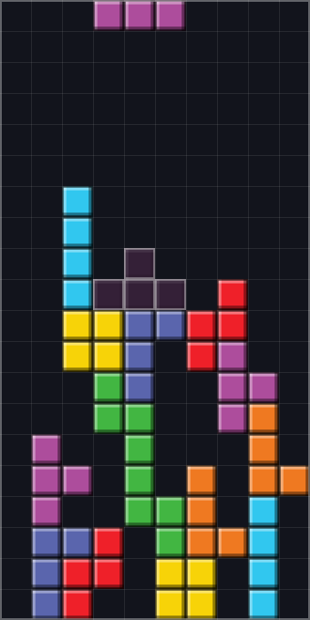
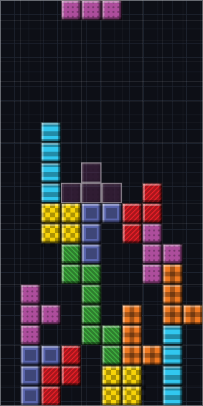
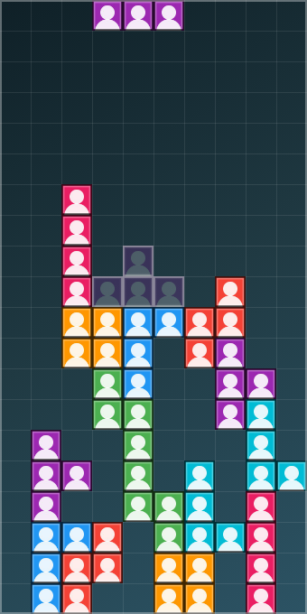

# Arquitetura

Documento técnico do projeto. Explica **como** as camadas se separam e, principalmente, **por quê**.

---

## 1. O problema que a arquitetura resolve

O requisito do projeto não é "fazer um Tetris". É fazer um Tetris em que, no futuro, os blocos coloridos possam ser substituídos por imagens (fotos de rostos) **sem reescrever a lógica de jogo**.

Num Tetris escrito de forma ingênua, a cor está espalhada por todo lado:

```js
// ✗ Como NÃO fazer — a cor invade a lógica
grid[linha][coluna] = '#ad4d9c';          // o tabuleiro guarda cor
if (grid[l][c] === '#ad4d9c') { ... }     // a colisão compara cor
ctx.fillStyle = grid[l][c];               // o desenho depende disso
```

Nesse desenho, trocar cor por imagem obriga a mexer em colisão, gravidade, limpeza de linhas e pontuação — tudo que encostou na cor. É o tipo de mudança que quebra um projeto inteiro.

A solução adotada é uma regra simples e absoluta:

> **O núcleo do jogo guarda apenas o identificador do tipo da peça. Nunca a aparência dela.**

```js
// ✓ Como o projeto faz — o tabuleiro guarda identidade, não aparência
this.celulas[linha][coluna] = 'T';        // só o TIPO da peça
```

A partir daí, "o que é um T" é uma pergunta que só a camada de renderização responde — e ela pode mudar de resposta a qualquer momento.

---

## 2. As camadas

```
┌──────────────────────────────────────────────────────────────┐
│                          src/main.js                         │
│      (composition root — o único que conhece todas)          │
└──────────────────────────────────────────────────────────────┘
        │                │                │              │
        ▼                ▼                ▼              ▼
┌──────────────┐  ┌─────────────┐  ┌───────────┐  ┌────────────┐
│   input/     │  │   core/     │  │  render/  │  │  storage/  │
│              │  │             │  │           │  │            │
│ teclado      │  │ LÓGICA PURA │  │ Canvas    │  │ localStorage│
│ toque        │  │             │  │ skins     │  │            │
│              │  │ sem DOM     │  │ gráficos  │  │            │
│              │  │ sem Canvas  │  │           │  │            │
│              │  │ sem cor     │  │           │  │            │
└──────────────┘  └─────────────┘  └───────────┘  └────────────┘
                         │                │
                         ▼                ▼
                  ┌─────────────┐  ┌────────────┐
                  │   audio/    │  │    ui/     │
                  └─────────────┘  └────────────┘
                                          │
                                          ▼
                                   ┌────────────┐
                                   │    ai/     │──▶ api/analisar.js
                                   └────────────┘      (servidor)
```

### Sentido das dependências

| Camada | Pode importar de | Nunca importa de |
|---|---|---|
| `core/` | apenas de `core/` | render, ui, input, audio, storage |
| `render/` | `core/` (só tipos de peça) | ui, input, audio, storage |
| `input/` | nada | todas as outras |
| `storage/` | `core/`, `render/` (constantes) | ui, input, audio |
| `ui/` | core, render, storage | — |
| `main.js` | todas | — |

**As setas apontam sempre para dentro.** `core/` não conhece ninguém; é possível apagar todas as outras pastas e o núcleo continua compilando e passando nos testes.

---

## 3. Como as camadas conversam

Duas direções, dois mecanismos:

### De fora para dentro: comandos

A entrada não chama o motor diretamente. Ela emite **comandos** — textos como `'esquerda'`, `'hardDrop'`, `'guardar'`:

```js
// src/main.js
const teclado = new KeyboardInput(executarComando);
const toque   = new TouchInput(executarComando, canvas, painelDeBotoes);
```

O mesmo comando pode vir do teclado, de um botão na tela ou de um gesto. O jogo não sabe a diferença — e um controle de videogame poderia ser acrescentado sem tocar em nada além de uma classe nova em `input/`.

### De dentro para fora: eventos

O motor **nunca chama a interface**. Ele apenas anuncia o que aconteceu, e quem se interessar escuta:

```js
// src/main.js — som e tela reagem sem que o motor os conheça
jogo.em('linhasLimpas', ({ quantidade }) => audio.tocarLimpeza(quantidade));
jogo.em('nivelAcima',   () => audio.tocar('nivel'));
jogo.em('fimDeJogo',    (resultado) => encerrarPartida(resultado));
```

Se amanhã o jogo precisar vibrar o celular ao limpar uma linha, basta acrescentar um ouvinte. `GameEngine.js` não muda.

---

## 4. O mecanismo de troca de aparência

Três arquivos, um padrão de projeto (*Strategy*).

### 4.1 O catálogo declara as aparências

`src/render/skins/catalogo.js` — só dados, nenhuma lógica:

```js
export const SKINS_DE_PECA = {
  classico: { tipo: 'cor',    mapa: { I: '#31c7ef', T: '#ad4d9c', ... } },
  retro:    { tipo: 'padrao', mapa: { I: 'listrado', T: 'pontilhado', ... } },
  turma:    { tipo: 'imagem', mapa: { I: 'assets/skins/ana.png', ... } },
};
```

### 4.2 A fábrica escolhe o pintor certo

`src/render/BlockPainter.js`:

```js
export function criarPintor(skin, tipoDePeca, carregador, corDeReserva) {
  switch (skin.tipo) {
    case 'cor':    return new PintorDeCor(skin.mapa[tipoDePeca]);
    case 'padrao': return new PintorDePadrao(skin.mapa[tipoDePeca], cor);
    case 'imagem': return new PintorDeImagem(skin.mapa[tipoDePeca], carregador, reserva);
  }
}
```

Os três pintores expõem exatamente o mesmo método:

```js
pintar(contexto, x, y, tamanho, opcoes)
```

### 4.3 O renderizador não sabe qual pintor tem em mãos

`src/render/CanvasRenderer.js`:

```js
const pintor = this.skins.pintorPara(tipo);
pintor.pintar(ctx, x, y, this.tamanhoDaCelula, { simbolo });
```

**É esta a fronteira do projeto inteiro.** Acima dela, tudo é identidade (`'T'`). Abaixo, tudo é aparência. Nenhum código de jogo atravessa essa linha.

### 4.4 Consequência prática

Trocar toda a identidade visual:

```js
skins.definirSkinDePeca('turma');   // uma linha
```

Isso funciona **com a partida em andamento**: o `SkinRegistry` refaz os pintores, avisa os interessados, e o próximo quadro já sai com a aparência nova. O tabuleiro, as peças e a pontuação continuam exatamente onde estavam.

### 4.5 Prova visual

As quatro imagens abaixo são **a mesma partida**, no mesmo instante, com as mesmas peças nas mesmas posições. A única coisa diferente é a skin ativa:

| Clássico | Retrô 8-bit | Fotos | Modo daltônico |
|---|---|---|---|
|  |  |  |  |

Repare que o modo daltônico desenha um símbolo dentro de cada peça — e que o `core/` **não sabe que acessibilidade existe**. O símbolo é decisão exclusiva do `BlockPainter`.

---

## 5. O tempo entra por um lugar só

`GameEngine.update(deltaMs)` é a única porta temporal do jogo:

```js
// src/main.js — o laço de animação mede o tempo e repassa
function laco(instante) {
  const delta = Math.min(instante - ultimoInstante, DELTA_MAXIMO_MS);
  ultimoInstante = instante;

  teclado.atualizar(delta);
  jogo.update(delta);
  desenhar();

  requestAnimationFrame(laco);
}
```

Nenhuma outra parte do jogo consulta o relógio. Três consequências:

1. **Testável fora do navegador.** Os testes chamam `jogo.update(1000)` e verificam que a peça desceu uma linha. Nenhum `setTimeout`, nenhuma espera real.
2. **Independente da taxa de quadros.** Em 30 Hz ou 144 Hz, a peça cai na mesma velocidade.
3. **Resistente a travadas.** O `DELTA_MAXIMO_MS` impede que voltar de uma aba em segundo plano derrube a peça de uma vez até o fundo.

---

## 6. Determinismo

O sorteio de peças usa um gerador com semente (`mulberry32`) em vez de `Math.random`:

```js
const jogo = new GameEngine({ semente: 12345 });
// A mesma semente sempre produz a mesma sequência de peças.
```

Isso permite que um teste afirme algo forte:

```js
test('mesma semente e mesmas jogadas produzem exatamente o mesmo resultado', () => {
  assert.equal(jogarPartida().pontos, jogarPartida().pontos);
});
```

E abre caminho para gravação de partidas no futuro: bastaria guardar a semente e a lista de comandos com seus tempos — poucos bytes reconstroem a partida inteira.

---

## 7. Padrões de projeto usados

| Padrão | Onde | Para quê |
|---|---|---|
| **Strategy** | `BlockPainter.js` | Trocar como um bloco é pintado sem mexer no renderizador |
| **Observer** | `GameEngine.em()`, `SkinRegistry.aoMudar()` | O motor avisa o mundo sem conhecê-lo |
| **Factory** | `criarPintor()` | Criar o pintor certo a partir de uma descrição declarativa |
| **Registry** | `SkinRegistry` | Um lugar só para saber qual aparência está ativa |
| **Dependency Injection** | `main.js` | Cada peça recebe o que precisa; nada se instancia sozinho |
| **Facade** | `GameEngine` | Uma interface simples sobre grid, rotação, sorteio e pontuação |

---

## 8. Decisões e alternativas descartadas

**Por que não usar um framework (React, Vue)?**
O jogo desenha em canvas, não em DOM. Um framework administraria uma árvore de elementos que aqui quase não existe, e ainda exigiria uma etapa de build. O que sobraria seria custo sem benefício.

**Por que não uma biblioteca de gráficos (Chart.js, D3)?**
Viria de CDN — e aí o jogo depende de um servidor de terceiros estar no ar — ou de `node_modules`, o que exige build. Ambos brigam com o requisito de funcionar offline. Três gráficos simples cabem em um arquivo.

**Por que não `<dialog>` nativo para os painéis?**
Comportamento inconsistente entre navegadores e, em ambientes de teste automatizado, nem sempre dispara os eventos de fechamento. Um contêiner com `[hidden]` é previsível e permite controlar o foco do jeito certo.

**Por que o áudio é sintetizado em vez de tocar arquivos?**
Nada para baixar (funciona offline), nada que dependa de um site de terceiros, e nenhuma dúvida sobre licença. O gancho para arquivos existe em `AudioManager.registrarAmostra()`, caso se queira trocar depois.

**Por que armazenar o tipo da peça, e não um objeto com tipo e cor?**
Guardar cor no tabuleiro faria a lógica depender da aparência — exatamente o que o projeto se propôs a evitar. O identificador é o mínimo necessário, e mínimo é o que sobrevive a mudanças.

---

## 9. Como estender

| Objetivo | O que fazer | O que **não** precisa mudar |
|---|---|---|
| Nova skin de cores | Uma entrada em `catalogo.js` | Nada mais |
| Peças com fotos | Uma entrada `tipo: 'imagem'` | Nenhum arquivo de lógica |
| Nova forma de pintar (vídeo, animação) | Uma classe em `BlockPainter.js` + um caso na fábrica | Renderizador e lógica |
| Novo modo de jogo | Uma entrada em `GameModes.js` | `GameEngine.js` |
| Novo controle (gamepad) | Uma classe em `input/` que emita os comandos existentes | Todo o resto |
| Nova métrica | Um campo em `StatsCollector.js` | Motor e interface |
| Reagir a um evento do jogo | `jogo.em('evento', ouvinte)` em `main.js` | `GameEngine.js` |

---

## 10. Verificação

```bash
npm test
```

37 testes, executados pelo runner nativo do Node, **sem abrir navegador**:

- colisão com paredes, chão e blocos fixados
- rotação SRS, incluindo o caso em que um *wall kick* salva a rotação e o caso em que ela é recusada
- limpeza de 1, 2, 3 e 4 linhas, com o tabuleiro mantendo a altura
- pontuação do Guideline e bônus de Tetris consecutivo
- progressão de nível e aceleração da queda
- 7-bag entregando as sete peças sem repetição
- regras de término de cada modo
- motor: gravidade, reserva bloqueada por peça, sombra, eventos, fim de jogo
- determinismo: mesma semente e mesmas jogadas geram resultado idêntico

O fato de esses testes rodarem no terminal é a **verificação prática da tese arquitetural**: a lógica não depende da tela. Se um dia precisarem de um canvas, a separação terá sido quebrada.
