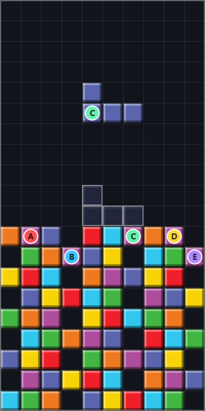
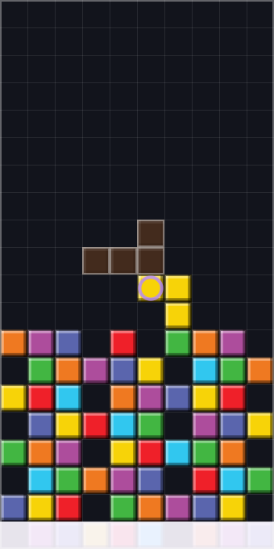

# Modo Professores Especiais

Documento do quinto modo de jogo: como funciona, como foi projetado e como estender.

---

## 1. O que é

Algumas peças nascem com um **bloco marcado por um professor**. Quando esse bloco fica encostado em outro bloco de professor — na horizontal ou na vertical — os dois somem e um **poder especial** é disparado.

|  |  |
|---|---|
| Cada professor é um disco colorido com a letra do id. A peça no ar carrega o Jhonatta (C); a sombra não recebe marca, porque ali ainda não há bloco. | A Cruz Acadêmica (Caetano + Jhonatta) atingindo duas linhas e duas colunas, com o clarão e a onda saindo do ponto da combinação. |

**Diagonal não conta.** Foi decisão de jogabilidade: encostar na diagonal aconteceria por acaso o tempo todo, e o jogador perderia o controle sobre quando o poder dispara.

---

## 2. Os cinco professores

| Id | Professor | Tema | Sozinho (quando é levado por uma linha limpa) |
|---|---|---|---|
| **A** | Alexandro | Explosão | Destrói a área 3×3 ao redor |
| **B** | Caetano | Linha | Elimina a linha em que está |
| **C** | Jhonatta | Coluna | Elimina a coluna em que está |
| **D** | Fabricio | Conversão | Preenche os 4 buracos mais fundos da pilha |
| **E** | Tadeu | Tempo | As próximas 2 peças caem na metade da velocidade |

Os **ids continuam sendo as letras A–E**: são a chave usada pelo tabuleiro, pela tabela de combinações e pelos arquivos salvos. Trocar um nome afeta apenas o que aparece na tela — é o ponto de separar identificador de rótulo. Basta editar o campo `nome` em [`src/core/Professores.js`](../src/core/Professores.js).

---

## 3. As 15 combinações

| Par | Poder | Efeito | Situação |
|---|---|---|---|
| A+A, B+B, C+C, D+D, E+E | **Aula Dobrada** | Explosão 3×3 | ✅ |
| A+B | **Explosão Horizontal** | Elimina duas linhas | ✅ |
| A+C | **Explosão Vertical** | Elimina duas colunas | ✅ |
| B+C | **Cruz Acadêmica** | Duas linhas e duas colunas cruzando o ponto | ✅ |
| B+D | **Linha Coringa** | Completa a linha, que limpa em seguida | ✅ |
| C+E | **Queda Controlada** | As próximas 3 peças caem a 40% da velocidade | ✅ |
| D+E | **Reorganização** | Compacta a pilha: os blocos caem e os buracos somem | ✅ |
| A+D | **Blocos-Bomba** | Marca 4 blocos vizinhos como bombas do Alexandro | ✅ |
| A+E | **Explosão Lenta** | Área 3×3 mais lentidão por 4 peças | ✅ |
| B+E | **Varredura Horizontal** | Varre a linha mais cheia; o resto desce | ✅ |
| C+D | **Coluna Coringa** | Tapa todos os buracos de uma coluna | ✅ |

**As 15 combinações estão implementadas.** O mecanismo de reserva permanece no código: um professor novo traria pares novos, e eles cairiam na Aula Dobrada em vez de não fazer nada — o jogador nunca encontra um par morto.

### Detalhes que vieram de ver os poderes em jogo

**Blocos-Bomba não usa estado novo.** Uma "bomba" é um bloco marcado com o Alexandro na matriz de professores. Assim ela já herda todo o comportamento existente: explode quando a linha dela é limpa, e combina se outro professor encostar. Inventar um terceiro estado obrigaria a ensinar renderizador, motor e persistência sobre um conceito novo.

**A Varredura procura a linha mais cheia**, não a linha do ponto da combinação. O ponto fica sempre no topo da pilha, onde a linha está quase vazia — na primeira versão o poder chegou a remover **um único bloco**. Procurar onde há mais o que limpar também combina melhor com a ideia de uma varredura atravessando o tabuleiro.

**A Coluna Coringa prioriza a coluna onde o jogador encaixou a peça** — a escolha que ele consegue prever. Se ali não houver buraco, vai para a coluna mais esburacada, em vez de ir embora sem fazer nada.

A tabela é consultada por **chave ordenada** (`'A|B'`), então A+B e B+A são o mesmo poder por construção, e não por duas entradas que poderiam divergir. Há teste garantindo isso para os 15 pares.

---

## 4. A tradução de match-3 para Tetris

A especificação original deste modo foi escrita para um jogo **match-3**: falava em "símbolos", "símbolo predominante" e "favorecer um Match". Nada disso existe no Tetris — a única mecânica de eliminação é completar uma linha horizontal.

Quatro efeitos precisaram ser traduzidos, preservando o tema de cada professor:

| Especificação original | Neste projeto | Por quê |
|---|---|---|
| D converte símbolos | **Preenche buracos** | Buraco é o inimigo real do Tetris |
| B+D linha coringa | **Completa uma linha** | O equivalente direto de "favorecer um Match" |
| C+D coluna coringa | **Preenche os vazios da coluna** | Mesma ideia, no eixo vertical |
| D+E reorganiza símbolos | **Compacta a pilha** | "Reorganizar" o tabuleiro, na gramática do Tetris |

Buraco é a métrica que mais separa jogador iniciante de experiente — o treinador de desempenho do jogo já a mede. "O professor conserta seu erro" é mais temático do que converter símbolo, e vira um poder que o jogador de fato deseja.

---

## 5. Como o modo preserva a arquitetura

O tabuleiro guarda apenas o identificador do tipo da peça (`'T'`), nunca aparência. Essa regra continua valendo: o professor **não** foi misturado dentro da célula.

Em vez disso, o `Grid` tem uma **matriz paralela**:

```js
this.celulas[l][c]     = 'T';   // tipo da peça — inalterado
this.professores[l][c] = 'B';   // quem está ali, ou null
```

As duas guardam **identidade, nunca aparência** — a mesma filosofia. A obrigação é mantê-las em sincronia: toda operação que mexe em uma mexe na outra, no mesmo instante. Há testes só para isso, porque uma linha removida de uma matriz e não da outra deixaria um professor flutuando sobre célula vazia.

A caricatura entra pelo caminho que já existia: [`BlockPainter.marcarProfessor()`](../src/render/BlockPainter.js) desenha o distintivo **por cima** do bloco já pintado. Sobrepor em vez de substituir é o que faz a marca funcionar igual com skin de cor, de textura ou de foto — um pintor separado para "bloco com professor" teria de existir em três versões e sairia de sincronia.

**Os quatro modos anteriores não mudaram.** O motor só liga o sorteio quando o modo tem `comProfessores: true`; nos outros, nem consulta o sistema. Há teste confirmando que Maratona, Sprint, Ultra e Zen continuam sem nenhum professor.

---

## 6. Regras de balanceamento

**Raridade.** Um professor a cada 3 peças, em média, com garantia de pelo menos um a cada 5. Medido em partida real: um a cada 2,8 peças. As duas constantes ficam no topo de [`ProfessorSystem.js`](../src/core/ProfessorSystem.js):

```js
export const PECAS_ENTRE_PROFESSORES = 3;
export const MAXIMO_DE_PECAS_SEM_PROFESSOR = 5;
```

**Pontuação.** Linhas eliminadas por poder valem a tabela normal, mas **não alimentam o bônus de Tetris consecutivo** — esse bônus premia quem montou o Tetris de propósito. Coluna eliminada vale 50 × nível, porque não completa linha.

**Gravidade.** Duas regras diferentes, e a distinção importa:

- **Linha esvaziada por completo desmorona**, e o resto desce — igual a uma limpeza normal. Um poder que apaga a linha inteira deixando a faixa vazia no lugar faz o tabuleiro parecer quebrado; foi um bug real, visto em jogo, e a correção está em `Grid.desmoronarLinhasVazias()`.
- **Blocos sem apoio que não formam linha vazia continuam flutuando**, como no Tetris clássico. Uma explosão 3×3 abre um vão e o vão fica. É o que dá identidade à Reorganização (D+E), o único poder que reacomoda a pilha coluna por coluna.

**Sem encadeamento.** Um poder pode completar linhas, que são limpas e pontuam normalmente — mas um poder **nunca dispara outro**. Sem esse limite, uma explosão que atinge outro professor poderia encadear até travar a partida. Há teste com três professores em fila confirmando que apenas um poder acontece.

**Efeitos duram peças, não segundos.** "As próximas 3 peças caem devagar" é uma promessa que o jogador confere olhando o tabuleiro. Medido em segundos, o efeito expiraria no meio de um encaixe, sem aviso, e pareceria bug. Como consequência, o sistema de efeitos não precisa de relógio — e roda igual no navegador e no terminal.

**Lentidão renova, não acumula.** Dois poderes de tempo seguidos dão mais duração, nunca uma lentidão mais forte. Multiplicadores empilhados travariam a peça no ar.

---

## 7. Determinismo

O sorteio de professores usa o **mesmo gerador com semente** do sorteio de peças. Mesma semente, mesma sequência de professores — é o que torna os testes confiáveis.

Uma consequência a saber: como os dois sorteios compartilham o gerador, a mesma semente produz **sequências de peças diferentes** no modo Professores e nos demais modos. Isso é esperado, e não afeta nada além da comparação direta entre modos.

---

## 8. Como estender

| Objetivo | O que fazer | O que **não** muda |
|---|---|---|
| Trocar os nomes A–E pelos reais | Campo `nome` em `Professores.js` | Todo o resto |
| Colocar as caricaturas | Campo `caricatura` em `PROFESSORES_VISUAL` (`catalogo.js`) | Nenhum arquivo de lógica |
| Alterar um poder | Uma função em `PoderesEspeciais.js` | Motor, renderizador, interface |
| Um sexto professor | Uma entrada em `Professores.js`, uma em `PROFESSORES_VISUAL` e as combinações novas | Detecção, sorteio e desenho |
| Mudar a raridade | As duas constantes em `ProfessorSystem.js` | Todo o resto |

### Escrevendo um poder novo

Um poder é uma função que recebe o tabuleiro e o ponto da combinação, mexe no grid e devolve um relatório. O relatório serve para pontuar, animar e testar ao mesmo tempo:

```js
function varreduraHorizontal(grid, ponto) {
  const relatorio = relatorioVazio('varredura', 'Varredura Horizontal');
  removerLinhaInteira(grid, ponto.linha, relatorio);
  return relatorio;
}
```

E registrar na tabela:

```js
const COMBINACOES = {
  // ...
  'B|E': { nome: 'Varredura Horizontal', executar: varreduraHorizontal },
};
```

A entrada correspondente sai automaticamente de `PREVISTAS_PARA_DEPOIS`, e a legenda na tela deixa de marcá-la como "Em desenvolvimento" — sem nenhuma alteração na interface.

---

## 9. Verificação

```bash
npm test
```

**48 testes** cobrem este modo, rodando no terminal sem navegador:

- vizinhança ortogonal detectada; **diagonal não dispara**
- A+B e B+A dão o mesmo poder, para os 15 pares
- os 15 pares têm resposta — nenhum cai em indefinido
- os cinco pares iguais compartilham literalmente a mesma função
- as 15 combinações estão implementadas, e todo par faz algo no tabuleiro ou no tempo
- **a marca do professor não pula de bloco ao girar a peça** (bug real corrigido)
- quatro giros devolvem a marca à célula original, nas sete peças
- a reserva devolve a peça com o professor e a posição que ela carregava
- a Varredura procura a linha mais cheia, não a do ponto da combinação
- a Coluna Coringa procura outra coluna quando a do ponto não tem buracos
- cada poder produz o efeito esperado num tabuleiro montado à mão
- limpar linha, remover bloco e compactar mantêm as duas matrizes em sincronia
- a lentidão estica o intervalo de queda e expira no número certo de peças
- um segundo efeito de lentidão renova a duração sem dobrar a força
- um poder não dispara outro
- **os outros quatro modos continuam sem professores**
- o sorteio é determinístico com a mesma semente
- linhas por poder não alimentam o bônus de Tetris consecutivo

No navegador, o modo foi verificado montando cenários com `window.__tetris`, disparando cada combinação e conferindo o desenho pelos pixels do canvas.
